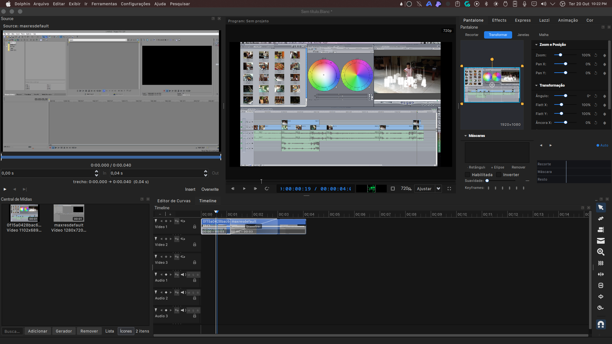

<div align="center">
  

  # Pierrot
  **0.8 alpha**

  Editor de vídeo simples para Linux — workflow rápido, sem complexidade.
</div>

> **Este app é para uso pessoal.** Não é ambicioso nem quer substituir nenhum
> software — o foco é o meu próprio uso: um workflow estável que eu conheço do
> **Windows**, agora no **Linux**.

O estilo vem do **Sony Vegas Pro** e **Final Cut Express (2003)**,
desenvolvido **exclusivamente para Linux**, escrito em
**C++** com **Qt Widgets** e **FFmpeg** (decodificação em processo + exportação via CLI).

A ideia do editor é: ser otimizado e ter um fluxo de trabalho rápido,
pra vídeos sem complexidade, pra uso meu.



## Recursos em destaque

- **Timeline** rápida com In/Out, multicâmera e time remapping.
- **Correção de cor Lumetri** por clipe + **12 modos de blend** por faixa.
- **Mesa** de composição 2D/3D leve (transform, câmera, malha `.obj`).
- **Efeitos** nativos + hosts **OFX** e **frei0r**.
- **48 presets de animação** e Graph Editor de keyframes.
- **Três idiomas** — Português, English e 日本語.
- **Temas** prontos (incl. Japan 95) e temas por paleta `.pierrot-theme`.

## Especificações

| Item                | Detalhe                                                     |
|---------------------|-------------------------------------------------------------|
| Formato de projeto  | `.Blanc` (JSON; salvamento assíncrono + backup rotativo). Carimba o **grupo de versão** — projetos de grupo mais novo são recusados, mais antigos são convertidos |
| Exportação          | MP4 (H.264/AAC), MKV (H.264/AAC), WebM (VP9/Opus)          |
| Resolução           | configurável (padrão 1920×1080)                             |
| Quadros/s           | configurável (padrão 30)                                    |
| Taxa de áudio       | 48 kHz (exportação)                                         |
| Correção de cor     | Lumetri por clipe: exposição, realces/sombras/brancos/pretos, sat/vibrance, temperatura/tint, Lift/Gamma/Gain, curvas RGB, vinheta, LUT `.cube`, nitidez |
| Efeitos por clipe   | vídeo: brilho, contraste, saturação, desfoque, P&B, chroma key, máscaras, motion blur, texto, LAINKA + hosts **OFX** e **frei0r**; áudio: EQ Express e Reverb EX |
| Fluxo de edição     | Source Monitor (In/Out, Insert/Overwrite), **multicâmera** (teclas 1..N), **Editor de Velocidade** (time remapping bezier) |
| Mesa (composição)   | camadas com transform/blend + câmera e malha `.obj` (3D leve) |
| Blend por faixa     | 12 modos + opacidade de faixa (0–100%)                      |
| Animação            | 48 presets + Graph Editor de keyframes (bezier)             |
| Idiomas             | Português, English, 日本語                                   |
| Temas               | prontos (incl. **Japan 95**) + temas por paleta `.pierrot-theme` |
| Zoom da timeline    | 2 px/s – 4000 px/s                                          |
| Fonte               | C++ (Qt Widgets) + FFmpeg (libav*)                          |

Para a lista completa de funcionalidades, veja **[FEATURES.md](FEATURES.md)**;
para as novidades de cada versão, veja **[CHANGELOG.md](CHANGELOG.md)**.

## Dependências (Ubuntu/Debian)

```bash
sudo apt install cmake g++ pkg-config ffmpeg \
    qt6-base-dev qt6-multimedia-dev \
    libavformat-dev libavcodec-dev libavutil-dev libswscale-dev libswresample-dev
```

`cmake` ≥ 3.16, `g++` com C++17 e `ffmpeg` no `PATH` (usado na exportação).

> **Qt6 é requisito.** O código usa APIs que só existem no Qt6 e não compila com Qt5.

## Compilar

```bash
cd Pierrot
cmake -B build -DCMAKE_BUILD_TYPE=Release
cmake --build build -j$(nproc)
./build/pierrot
```

## Como usar

1. Clique em **Adicionar** no painel Mídia e escolha seus arquivos.
2. Arraste um item da lista para uma faixa de vídeo (ou áudio) na timeline.
3. Mova a régua (clique na parte superior) para posicionar o playhead.
4. `S` divide o clipe na posição do playhead; `Delete` remove o selecionado.
5. **Arquivo → Exportar…** (Ctrl+E) para gerar o vídeo final.

## Agradecimentos e inspirações

Pierrot é inspirado em **2 programas**: **Sony Vegas 8** e **Final Cut Express
2003** — totalmente escrito pra Linux, para uso pessoal, baseado nas ferramentas
que eu acho úteis.

Agradecimentos especiais a **Gumduck**, por ajudar a desenvolver o áudio e
features.

Inspirações adicionais e o que cada uma ajudou a moldar:

- **Adobe Premiere Pro** — painel de Efeitos, Effect Controls (Propriedades),
  Media Pool, Source Monitor e o mixer de áudio.
- **Adobe After Effects** — o canvas de composição (Mesa), a faixa de efeitos
  expandível e o Graph Editor de keyframes.
- **DaVinci Resolve** — organização por categorias nas configurações e o visual
  de cor/timecode.
- **Blender** — o HUD de transformação do canvas Mesa.

Estudos que moldaram decisões técnicas:

- **Kdenlive** — estabilidade: a prioridade é **não perder trabalho** (backup
  rotativo do `.Blanc`, save assíncrono, teste real de export, crash reporter).
- **Filmcraft** e **Oliver** — reprodução de vídeo: arquitetura do pipeline de
  playback e do monitor (decodificação em processo, threads de render).

O **motor de codecs** do Pierrot, o **Laartman** (`src/laartman/` — `Decoder`,
`FFmpegDecoder`, `Demuxer`, `PacketReader`, v0.4), vem da preocupação de **não
travar** (decodificação estável, como no estudo do Kdenlive) e de **não perder
trabalho** (save/backup a prova de queda), com playback fluido no monitor
inspirado no Filmcraft e no Oliver. Desde a reestruturação v0.4 o Laartman
**só decodifica** — pool, prefetch e escolha de qualidade são política do
Pierrot (Colombina/L4). Cuidado real:

- fachada pública `Decoder` congelada (L3): sem posse/lease/política no header;
- **contrato de leitura substituível** (`MediaReader`, §8.8) e **desfecho
  tipado** por quadro — Ok/Eof/Cancelled/Error, sem adivinhar a partir de imagem
  nula (§8.3);
- vídeo com **contexto de demux próprio** + thread de leitura à frente
  (`PacketReader`, buffer limitado) — disco lento não para o decode;
- áudio independente do vídeo (PTS, sem cadeia de mutex cruzada);
- VAAPI com auto-cura, detecção VFR, ocultação de erro (último quadro bom);
- cancel cooperativo em todo `frame()` (aborta em ~20 ms, progresso preservado);
- **paridade preview↔export** verificada por teste automático sobre mídia
  decodificada (§8.7).

Ainda estudando para melhorar a reprodução.

## Licença

Pierrot está sob a **GPL-3.0**. É uso pessoal, mas o código é aberto — se
alguém quiser forkar, é só fazer.

- Texto completo: [LICENSE](LICENSE) (GPL-3.0).
- Copyright (C) 2026 **theinkspoty**.
